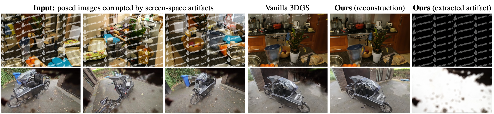

# SSA-3DGS: Unsupervised Removal of Screen-Space Artifacts for 3D Gaussian Splatting [WACV 2027]

Kristof Overdulve, Lode Jorissen, Nick Michiels
Digital Future Lab, Flanders Make, Hasselt University

[**arXiv**](https://arxiv.org/abs/2607.05598) | [**Dataset**](https://huggingface.co/datasets/KeejOow/SSA3DGS)



*Given posed images corrupted by an artifact fixed in the camera frame, vanilla 3DGS bakes it into the scene, whereas SSA-3DGS recovers the clean scene **and** the artifact, without masks or supervision.*

## Abstract

Novel View Synthesis (NVS) methods, such as 3D Gaussian Splatting (3DGS), rely on the assumption of clean, multi-view consistent, posed input images. Real-world captures can violate this assumption due to **screen-space artifacts** — static occlusions fixed to the 2D image plane rather than to the 3D world. Common examples include physical sensor defects, environmental obstructions (such as rain or mud on the lens enclosure), capture obstructions (such as a thumb over the camera sensor or a dashboard visible in dashcam footage), and digital overlays (such as watermarks or UI elements). When present, they are erroneously baked into the 3D geometry as "floaters" or near-camera artifacts, degrading the quality of novel-view rendering. In this work, we propose *SSA-3DGS*, an unsupervised framework that jointly optimizes a 3D scene and a learnable 2D overlay to recover a clean 3D scene and the corrupting artifacts. By exploiting geometric consensus across views, our method effectively disentangles static artifacts from the 3D scene geometry without supervision or manual input. Across diverse synthetic corruptions and a self-captured real-world dataset, SSA-3DGS improves reconstruction fidelity by up to ~8 dB PSNR over 3DGS trained on the same corrupted inputs, while faithfully preserving the corrupting artifact.

## Citation

```bibtex
@misc{overdulve2026ssa3dgs,
      title={SSA-3DGS: Unsupervised Removal of Screen-Space Artifacts for 3D Gaussian Splatting}, 
      author={Kristof Overdulve and Lode Jorissen and Nick Michiels},
      year={2026},
      eprint={2607.05598},
      archivePrefix={arXiv},
      primaryClass={cs.GR},
      url={https://arxiv.org/abs/2607.05598}, 
}
```

## Funding and acknowledgements

We gratefully acknowledge imec IDLab for computational resources via the iLab.t infrastructure.

This codebase is built on the excellent [gsplat](https://github.com/nerfstudio-project/gsplat) library and derives its trainer from the gsplat example trainer (Apache-2.0). The synthetic benchmark builds on the [Mip-NeRF 360](https://jonbarron.info/mipnerf360/) dataset, artifacts are composited with [Albumentations](https://albumentations.ai/), and evaluation uses NVIDIA's [FLIP](https://github.com/NVlabs/flip) metric.

## Installation

Tested with CUDA 11.8 and Python 3.10 on a single NVIDIA V100 (32 GB). Any recent CUDA GPU with ≥ 16 GB should work for most scenes; the largest MCMC runs (bicycle/garden at `cap-max` ≈ 5–6 M Gaussians) want 32 GB.

### Option A: Docker (recommended)

```bash
docker build -t ssa3dgs .
```
or
```
docker pull kroverdulve/ssa3dgs:latest && docker tag kroverdulve/ssa3dgs:latest ssa3dgs
```

```
docker run --gpus all -it --rm \
    -v /path/to/your/workdir:/workspace \
    -p 8080:8080 \
    ssa3dgs
```

Everything below (data preparation, training, evaluation) is then run inside the container from `/home/user/code`, with `<DATA_ROOT> = /workspace/data` and `<OUTPUT_ROOT> = /workspace/outputs`.

### Option B: step by step

The steps mirror the Dockerfile:

```bash
# 1. System: Ubuntu 22.04 with the CUDA 11.8 toolkit, Python 3.10, and
#    build-essential/ninja (gsplat JIT-compiles its CUDA kernels on first use).
#    COLMAP is only needed to pose your own captures.
sudo apt-get install build-essential ninja-build python3.10-dev python3-pip curl ffmpeg colmap

# 2. PyTorch for CUDA 11.8.
pip install torch torchvision --index-url https://download.pytorch.org/whl/cu118

# 3. Everything else (gsplat, pycolmap, viewer, metrics, albumentations).
pip install -r requirements.txt

# 4. (optional, speeds up the first run) restrict the JIT build to your GPU,
#    e.g. for an RTX 3090:
export TORCH_CUDA_ARCH_LIST="8.6"
```

Notes:
- `gsplat` compiles its CUDA kernels on the first `python train.py ...` call; this takes a few minutes once.

## Preparation

Download [our dataset](https://huggingface.co/datasets/KeejOow/SSA3DGS) to `<DATA_ROOT>` (a directory of your choosing; we use the placeholders `<DATA_ROOT>` and `<OUTPUT_ROOT>` from now on; the `run_*.py` scripts and `ssa3dgs.sh` take both as their first two arguments) or prepare your own data as a regular COLMAP dataset (see [Training on your own data](#training-on-your-own-data)). The only naming requirement: training images are prefixed `corr_` and (should you have them) clean evaluation images are prefixed `clean_`; datasets without prefixes use every image for training and skip evaluation. All outputs are written under `<OUTPUT_ROOT>`, again a directory of your choosing.

`run_synthetic.py` takes the synthetic benchmark root (one subfolder per artifact, e.g. `<DATA_ROOT>/360_v2_prep`); `run_real.py` takes the folder that directly contains the real scenes (e.g. `<DATA_ROOT>/my`). To rebuild the synthetic benchmark from the original Mip-NeRF 360 scenes instead of downloading it:

```bash
# The seven public Mip-NeRF 360 scenes (~12 GB) -> <DATA_ROOT>/360_v2/
python datasets/download_dataset.py --dataset mipnerf360 --save-dir <DATA_ROOT>

# Composite the five artifact types + the clean reference copy. Downscaling
# (x2 indoor, x4 outdoor, following the Mip-NeRF 360 protocol) happens here,
# so training reads the prep folders without a data factor.
python prepare_watermark_dataset.py \
    --scenes_root <DATA_ROOT>/360_v2 --output_root <DATA_ROOT>/360_v2_prep \
    --artifacts watermark ui dashboard rain mud clean
```

## Training

`ssa3dgs.sh` is the single entry point every experiment goes through; the `run_*.py` scripts call it in sequence to reproduce the paper.

### All scenes (reproduce the paper)

```bash
# Tab. 1 + Tab. 3 (synthetic): Baseline 3DGS, Ours, and the
# no-regularizer / constant-init ablations, for ADC and MCMC.
python run_synthetic.py <DATA_ROOT>/360_v2_prep <OUTPUT_ROOT>

# Tab. 2 (real, "Ours" row): SSA-3DGS at the paper settings on every real
# scene (ADC, lambda_sparse 0.01, statistics init).
python run_real.py <DATA_ROOT>/real/ <OUTPUT_ROOT>
```

`run_synthetic.py` prints every command before running it and a failure summary at the end; edit the constants at the top to narrow the grid. `run_real.py` is a single `ssa3dgs.sh` call over all discovered scenes. A single run is 7 (synthetic) or 15 (real) scenes at 30k iterations each, so reproducing everything takes several GPU-days on a single card.

### Per scene

`ssa3dgs.sh <data_root> <output_root> <subset> <dens> <artifact> <exp> <remove> <lr> <from_iter> <l1> <tv> [init]` trains every scene of a subset, e.g. SSA-3DGS (MCMC) on the synthetic watermark category:

```bash
bash ssa3dgs.sh <DATA_ROOT>/360_v2_prep <OUTPUT_ROOT> 360v2 mcmc watermark main 1 0.005 0 0.05 0.0 statistics
```

For one single scene, call the trainer directly. The paper settings are: overlay learning rate `5e-3`, overlay active from step 0, `lambda_sparse = 0.05` for the synthetic categories except mud (`0.01`), `0.01` for the real scenes, TV weight `0`, statistics initialization, 30k iterations (all `train.py` defaults follow gsplat's 3DGS defaults, `ssim_lambda = 0.2`):

```bash
# ADC densification
CUDA_VISIBLE_DEVICES=0 python train.py default --disable_viewer \
    --remove_watermark --watermark_lr 0.005 --watermark_from_iter 0 \
    --watermark_l1_reg 0.05 --watermark_tv_reg 0.0 --watermark_init statistics \
    --data_dir <DATA_ROOT>/360_v2_prep/watermark/garden \
    --result_dir <OUTPUT_ROOT>/demo/garden

# MCMC densification: same flags, plus the per-scene Gaussian budget
CUDA_VISIBLE_DEVICES=0 python train.py mcmc --strategy.cap-max 5200000 \
    --disable_viewer \
    --remove_watermark --watermark_lr 0.005 --watermark_from_iter 0 \
    --watermark_l1_reg 0.05 --watermark_tv_reg 0.0 --watermark_init statistics \
    --data_dir <DATA_ROOT>/360_v2_prep/watermark/garden \
    --result_dir <OUTPUT_ROOT>/demo/garden_mcmc
```

MCMC `--strategy.cap-max` budgets per scene (the same maximum number of splats as the original per-scene configurations; see `ssa3dgs.sh`): bicycle 5.9M, bonsai 1.3M, counter 1.2M, garden 5.2M, kitchen 1.8M, room 1.5M, stump 4.75M; real scenes 3M.

Baselines from the paper: `Baseline 3DGS` is the same command without the `--remove_watermark ...` flags; `Clean (Ref)` is that baseline trained on `<DATA_ROOT>/360_v2_prep/clean/<scene>`.

### Outputs

Each run writes to its `--result_dir`:

```
ckpts/ckpt_<step>_rank0.pt        model checkpoint
stats/val_step29999.json          PSNR / SSIM / LPIPS / FLIP + num_GS (mean over all test views)
stats/train_step*_rank0.json      runtime, memory, num_GS
renders/val_step<step>_<i>.png    per-test-view strip: [ GT | render | depth | overlay-on-white ]
watermark/..._bg{black,white}.png the extracted overlay A*W over black / white
cfg.yml                           the full resolved config of the run
```

Metrics are computed between the held-out clean test views and the **clean render** (the 3D scene *without* the overlay), so they measure the restoration quality of the underlying scene — this matches the paper's protocol.

### Training on your own data

1. **Capture.** Record the corrupted scene (the artifact must stay fixed relative to the camera). For quantitative evaluation, record a second, artifact-free pass of the same scene; for qualitative use, one corrupted pass is enough.
2. **Pose with COLMAP** (single reconstruction over *all* images so both passes share one coordinate system), then undistort:
   ```bash
   colmap automatic_reconstructor --workspace_path scene/ --image_path scene/images
   colmap image_undistorter --image_path scene/images \
       --input_path scene/sparse/0 --output_path scene/undistorted
   ```
3. **Name the split.** Prefix corrupted training images `corr_` and clean test images `clean_` (the loader then uses exactly that split). If no image carries a prefix, all images are used for training and evaluation is skipped. You can also provide explicit `train.txt` / `val.txt` files with comma-separated COLMAP image ids in the scene folder.
4. **Train.** The real-scene settings are a good starting point; lower `--watermark_l1_reg` towards `0.01` when the artifact covers large, contiguous regions:
   ```bash
   CUDA_VISIBLE_DEVICES=0 python train.py default --disable_viewer \
       --remove_watermark --watermark_lr 0.005 --watermark_from_iter 0 \
       --watermark_l1_reg 0.01 --watermark_tv_reg 0.0 --watermark_init statistics \
       --data_dir scene/undistorted --result_dir <OUTPUT_ROOT>/my_scene
   ```
   Notes: the method needs a reasonably dense capture (multi-view parallax is the training signal), and the overlay assumes the artifact is *static* in the image frame — see the paper's limitations section.

## Rendering and inspection

- **Interactive viewer** (viser, port 8080): drop `--disable_viewer` from any training command and open `http://localhost:8080`. RGB / depth / alpha render modes are available while training.
- **Evaluate / re-render a trained model:** pass the checkpoint to the same command the model was trained with; this re-runs the full evaluation (renders + stats) without training:
  ```bash
  CUDA_VISIBLE_DEVICES=0 python train.py default --disable_viewer \
      --data_dir <DATA_ROOT>/360_v2_prep/watermark/garden \
      --result_dir <OUTPUT_ROOT>/demo/garden_eval \
      --ckpt <OUTPUT_ROOT>/demo/garden/ckpts/ckpt_29999_rank0.pt
  ```
- **Export a .ply** for external splat viewers (e.g. SuperSplat): add `--save_ply` during training; the point cloud lands in `<result_dir>/ply/`.
- **The extracted artifact** of every run is in `<result_dir>/watermark/` (composited over black and white; the paper figures show whichever is more legible).

## License

Apache License 2.0 (see [LICENSE](LICENSE)). The trainer derives from the [gsplat](https://github.com/nerfstudio-project/gsplat) example trainer, also Apache-2.0.
